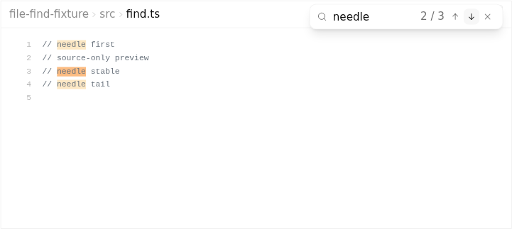
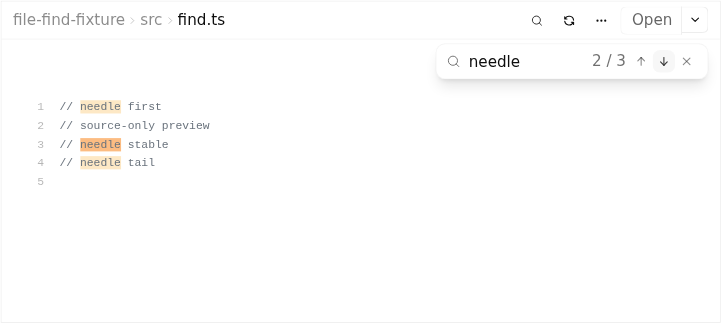
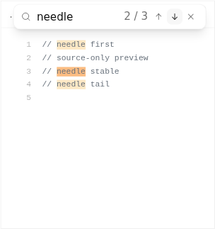
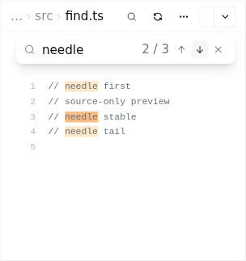

# File preview find: before versus after the header repair

These are actual Chromium renders of `WorkspaceFilePreview`, with production CSS and Shiki, from source-pinned workflow [38147955720](https://github.com/Emanuele-web04/synara/actions/runs/38147955720). The fixture supplies a synthetic file through the native read-file boundary. It does not change application source. This comparison isolates the final header-overlap repair; the PR retains the earlier feature screenshots separately.

| Capture | Exact application source | Tree | Result |
| --- | --- | --- | --- |
| Before | `ed3ad6f3818ee00e677e8822f2daf3a9d54f0d90` | `b16327f0d7f9e41cb80ba559a9bf4c1affe09514` | Find overlay covers the Reload button's center at 760px and 320px pane widths. |
| After | `2db658e39dbf585511c0dd680357be08b2a9f6cd` | `acbd68de75368fd487996e9668d8c88aa5ba3184` | Compact find row leaves Reload reachable and stays inside the pane; real pointer Reload preserves the active content offset as the first match disappears. |

The reviewed evidence driver is `436fce98b57f2e3695545ff152dbea66201d94e4`. Both jobs passed. Each side contains two unedited PNGs and the source/driver/image-hash provenance returned by the workflow. The screenshot name identifies CSS pane width; actual output pixel dimensions include the application's normal zoom.

| Pane width | Before | After |
| --- | --- | --- |
| 760px |  |  |
| 320px |  |  |

Artifacts: before `11705329130` (`sha256:e23d548d219186f0cd2d03603a35345fbde25d7ac0140a54e0981f2e025221f3`); after `11705194531` (`sha256:b33ea96b28911889f3ad16c6de76fd2033e642e1afc01162b2d830b77cc17eb5`). The PNG hashes are recorded in the adjacent provenance files and were checked again after download.
