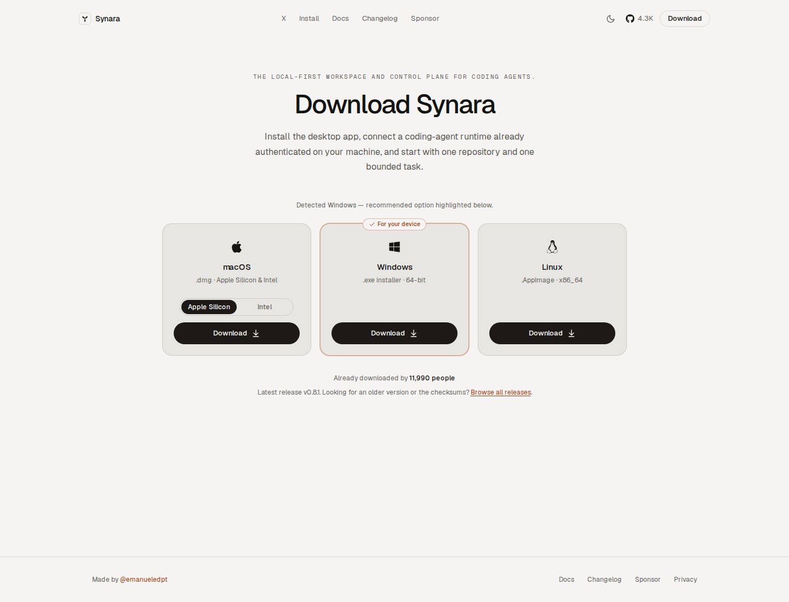
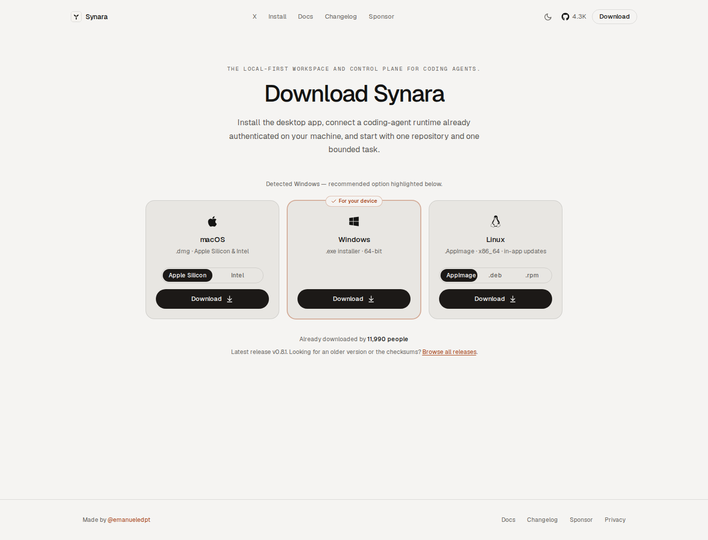
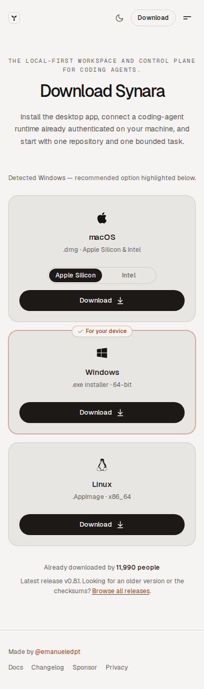
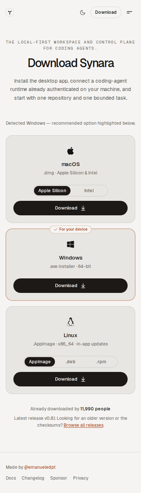
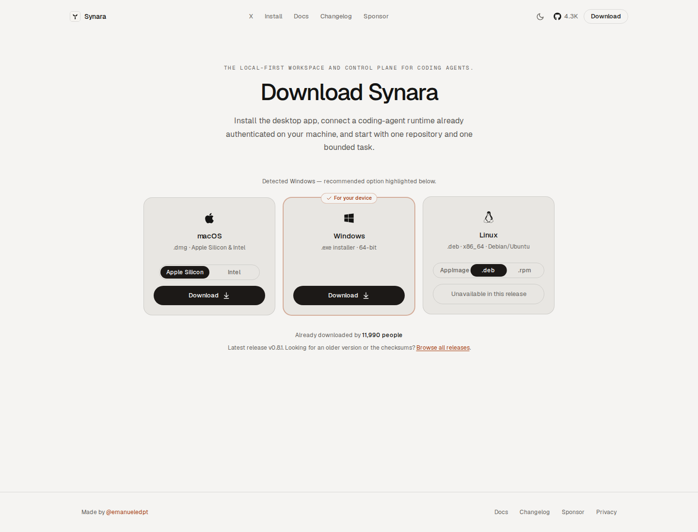
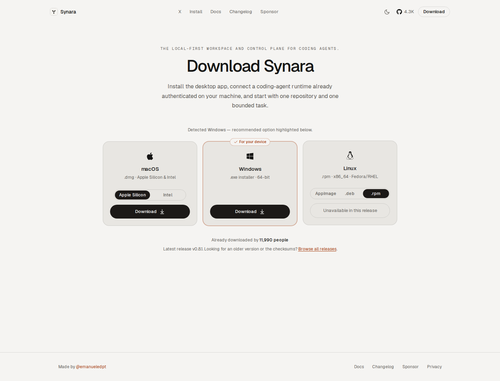
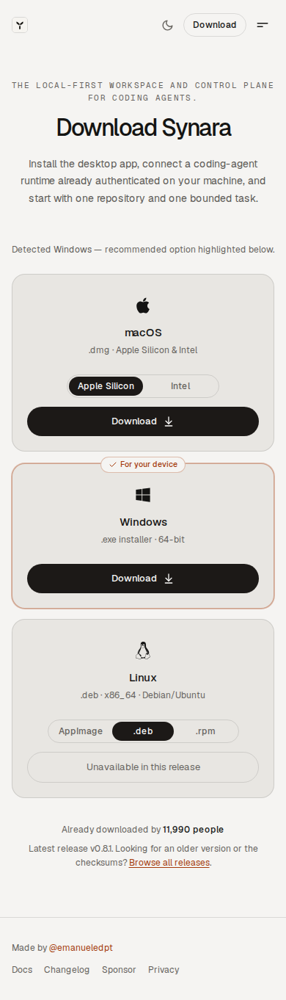
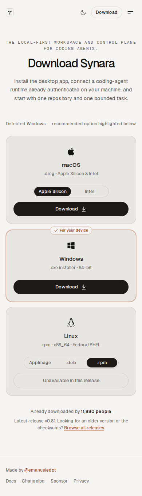

# PR #1823 — Before vs After

Actual production Next.js `/install` screenshots captured with Chromium on Ubuntu 24.04 and macOS 15. These PNGs are unchanged browser output.

- **Before:** main `ec8c940e07582454a475250ade40147e3c89d59f`, tree `26c3b060469f224dce8135d8046697eb43fe0794`.
- **After:** Linux-format feature `77ea643504f5ab5908176669a2056205014bbfe2`, tree `1f6494d1746b5bf66a62872a5d25460795a82faa`.
- **Independent capture driver:** `14d56588b23dbe4f400998191cb50beb7ac2b7c8`; [run 38155614712](https://github.com/Emanuele-web04/synara/actions/runs/38155614712).
- The production source and original visual test/helper were unchanged. Only an additive capture spec/config was copied in. The original helper fixes platform detection, theme, motion, and volatile data; the page intentionally displays its fixed Windows recommendation on both runner operating systems.
- Fixture: checked-in **v0.8.1** release. Its AppImage exists; Debian and RPM assets are absent. The screenshots do not claim that a public Debian/RPM release has been published.

## Desktop — 1440 × 1100

| Before | After |
| --- | --- |
|  |  |

## Mobile — 390 × 844 viewport, full-page captures

| Before | After |
| --- | --- |
|  |  |

## Selecting unavailable formats

The same actual browser session selects Debian, selects RPM, and returns to AppImage. Assertions require the selected format, an unavailable/disabled action with no Linux download link for the two missing assets, and restoration of the exact AppImage link. Both viewports passed on both operating systems.

| Debian | RPM |
| --- | --- |
|  |  |
|  |  |

[macOS desktop before](darwin/before/desktop-appimage.png) · [macOS desktop after](darwin/after/desktop-appimage.png) · [macOS mobile before](darwin/before/mobile-appimage.png) · [macOS mobile after](darwin/after/mobile-appimage.png). All native captures, including the Debian/RPM states on macOS, are included in the corresponding folders.

## Original assertions and qualification

| Original snapshot against checked-in baseline | Result |
| --- | --- |
| Linux Before | Passed, exit 0. |
| Linux After | Failed, exit 1: 2,232 differing pixels for the intended new Linux controls and subtitle. |
| macOS Before | Failed, exit 1: 763 differing pixels. The existing golden says v0.7.0; the actual current source/fixture says v0.8.1. |
| macOS After | Failed, exit 1: 2,839 differing pixels, combining the intended Linux controls with that existing release-version drift. |

All four production builds and all four desktop/mobile capture jobs passed their actual checks. The workflow remains failed for the three original-baseline failures; they were not ignored or reclassified as passes. Their raw logs and exit records are included.

After separate generation, the candidate Linux golden equals the actual After PNG byte-for-byte. The candidate macOS golden differs from its actual After PNG by 12 antialiasing pixels on the unchanged recommendation badge. Actual same-machine macOS Before vs After changes occupy only the Linux control/subtitle region. Review accepted the two refreshed install goldens without changing the existing 50-pixel tolerance, test assertions, or application source.

Root independently viewed the Before/After desktop captures, mobile RPM state, Debian disabled state, both macOS source captures and the old expected/diff image. Artifact ZIP digests and all **119 files listed in completed provenance manifests** were verified. Further source/head CI and native package installation are recorded on [PR #1823](https://github.com/Emanuele-web04/synara/pull/1823).

## Artifact identities

See [artifact-receipts.json](artifact-receipts.json), per-platform `provenance.json`, observation files, and the original snapshot result/log files. Full Actions artifacts also retain real recordings and traces.

| Runner / version | Artifact | SHA-256 |
| --- | --- | --- |
| Ubuntu After | 11708258054 | `cd0f97859cc052bcfa94d23b40748898dec55e2e856f7b4d36e9d1f7604da6ed` |
| Ubuntu Before | 11708003837 | `a98181b88482e2a1d10ec382d23eeb7f98e8b2bba69ef267a1013c39df661fcc` |
| macOS After | 11708660113 | `b2ba7b6472c2792823c834c30d2552b88998d07556f1b7a495ef1e5d51bcba73` |
| macOS Before | 11707944379 | `d7a1780d7c55f61a6c2e6f7a609748414a13e4fd578aa0f8dbe5216eb4eab82e` |

This evidence qualifies the rendered install controls and their interaction under the explicit release fixture. It does not establish live release availability, installer execution, signing, or a native application session.
